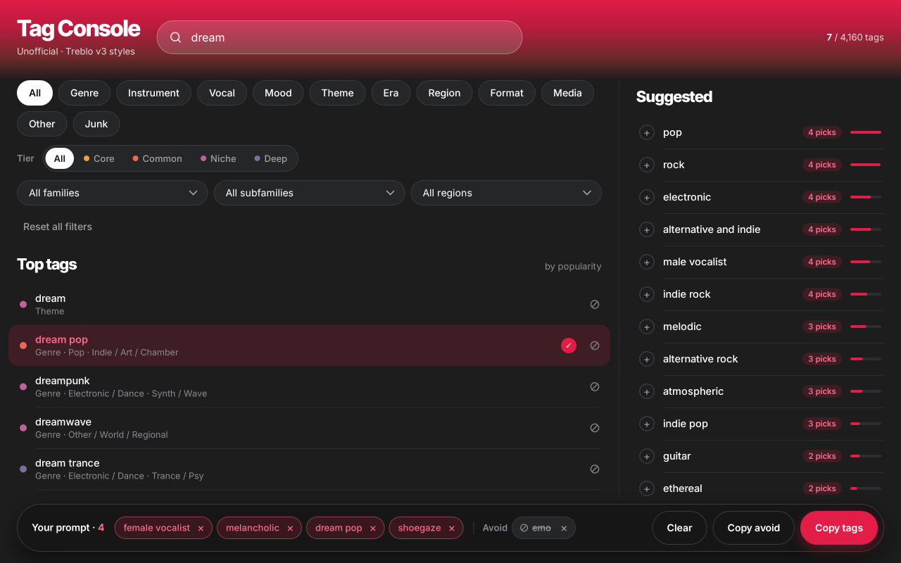
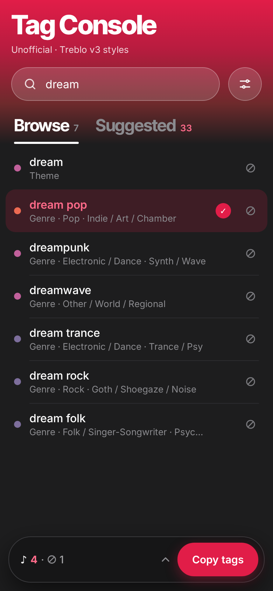
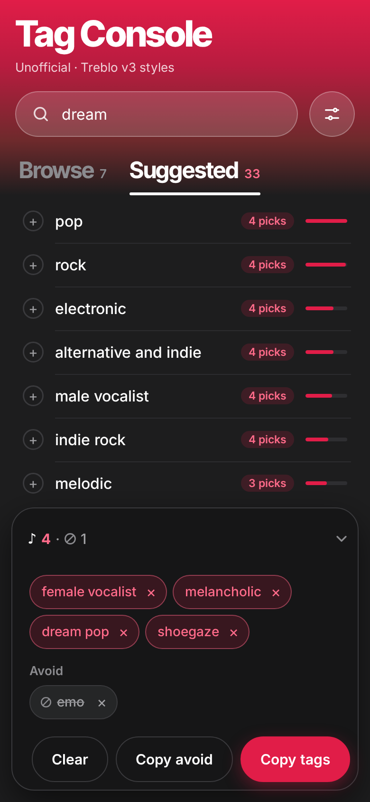

# Tag Console

An unofficial browser for the 4,160 Treblo v3 style tags (Treblo was called Sonauto until June 2026). Filter by category, genre family, region and popularity tier, then build a tag list and copy it into Treblo. You can also mark tags to avoid and copy those as a separate list, for Treblo v3's negative tags.

**Live:** https://metalzealot.github.io/treblo-tag-console/

Not affiliated with Treblo or Sonauto, Inc.

  
  

## Run it

It's one static page with no build step. Open `index.html` in a browser, or serve the folder.

GitHub Pages serves the `main` branch root, so every push to `main` updates the live page.
